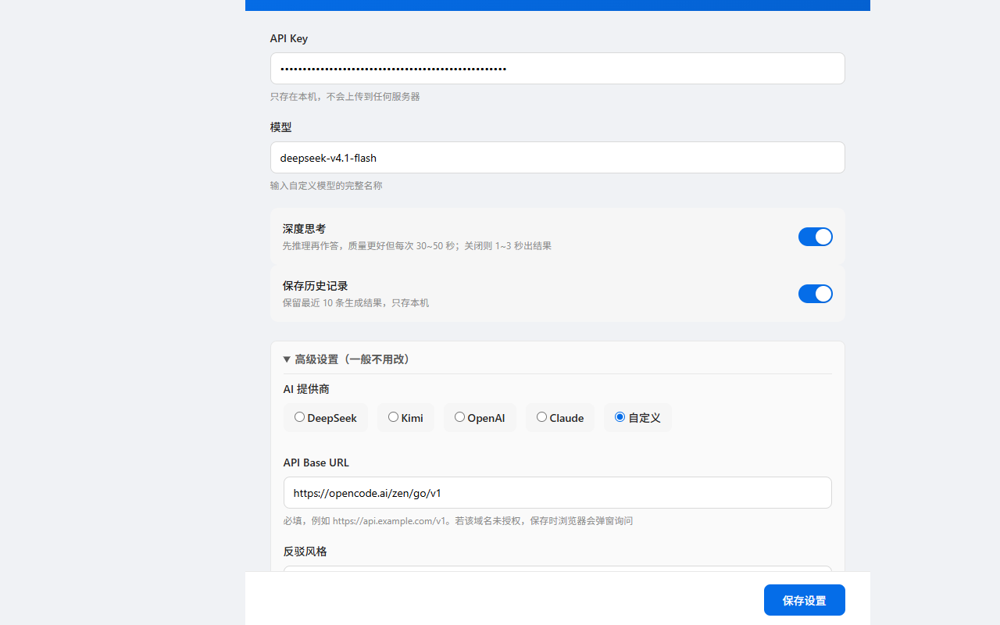

# 知乎反驳助手

在知乎回答下方加一个「🛡️ 生成反驳」按钮：点一下，AI 读完这条回答，给你一段**可以直接发到评论区的文字**。不自动发布——发不发、改不改，都由你决定。



## 它做什么

- 提取回答正文，找出可核验的事实错位、逻辑跳跃、以个案推全体
- 生成 2~4 段评论：每段给一个具体证据（条文、年份、数字、书名），并指出推理断在哪
- 一键填进知乎评论框，或复制走

## 它不做什么

- 不自动发布、不点赞、不关注、不批量操作
- 不收集浏览记录，不上传到开发者服务器（无后端）
- 不读取知乎以外的页面

## 安装

1. 下载 `dist/` 下的 zip（或 [Releases](https://github.com/ejacky/zhihu-remark/releases)）并解压
2. 打开 `chrome://extensions`（Edge 用 `edge://extensions`），打开右上角「开发者模式」
3. 点「加载已解压的扩展程序」，选择解压后的目录

开发者本地调试：直接选本仓库根目录即可，改完代码按 AGENTS.md §2 重载。

## 使用

1. 点扩展图标 → 打开设置页，填 **API Key**，点「同步模型」选模型（其余用默认值）
2. 打开任意知乎回答，点「🛡️ 生成反驳」
3. 等 30~60 秒（默认开启深度思考），读一遍、按需修改，自己点发送

需要自备 AI API Key（DeepSeek / Kimi / OpenCode Go / OpenAI / Claude，或任何 OpenAI 兼容端点）。费用由服务商直接向你收取，扩展不参与计费。

## 设置只有四项

| 项 | 说明 |
|---|---|
| API Key | 必填，只存本机 |
| 模型 | 点「同步模型」从服务商列表里选，也可手填 |
| 深度思考 | 开：30~60 秒、质量更好；关：1~3 秒 |
| 保存历史 | 保留最近 10 条，只存本机 |

提供商、API 地址、风格、自定义 Prompt 后缀收在「高级设置」里。内置提供商的 Base URL 已经填好，不用手填；需要代理 / 镜像时才勾选覆盖。

## 隐私

API Key 与生成记录只存在本机 `chrome.storage.local`。生成时只把当前回答的正文发给你自己选定的 AI 服务商，开发者既收不到也不中转。完整政策见 [docs/STORE.md](docs/STORE.md) 第十节。

## 文档

| 想了解 | 读 |
|---|---|
| 架构、数据流、消息协议、存储、错误处理 | [docs/TECH_DESIGN.md](docs/TECH_DESIGN.md) |
| Prompt 怎么写、怎么调 | [docs/PROMPT_DESIGN.md](docs/PROMPT_DESIGN.md) |
| 使用与常见问题 | [docs/USER_GUIDE.md](docs/USER_GUIDE.md) |
| 商店上架文案 | [docs/STORE.md](docs/STORE.md) |
| 变更日志与待办 | [docs/ROADMAP.md](docs/ROADMAP.md) |
| 改代码前必读（规则、验证清单、发版流程） | [AGENTS.md](AGENTS.md) |

## 开发

纯原生 JS + HTML/CSS，**无 npm、无构建**，仓库根目录就是可加载的扩展。三套自动化测试，全部零依赖、不联网：

```powershell
node tests/prompt/rules.test.mjs     # Prompt 回归网
node tests/docs.test.mjs             # 文档完整性
node tests/options/models.test.mjs   # 设置页模型目录（端点 / 鉴权 / 解析）
```

## 状态

已在 Chrome 应用商店上线，当前版本与历史构建见 [Releases](https://github.com/ejacky/zhihu-remark/releases)。版本语义与发版流程见 [AGENTS.md](AGENTS.md) §7。
